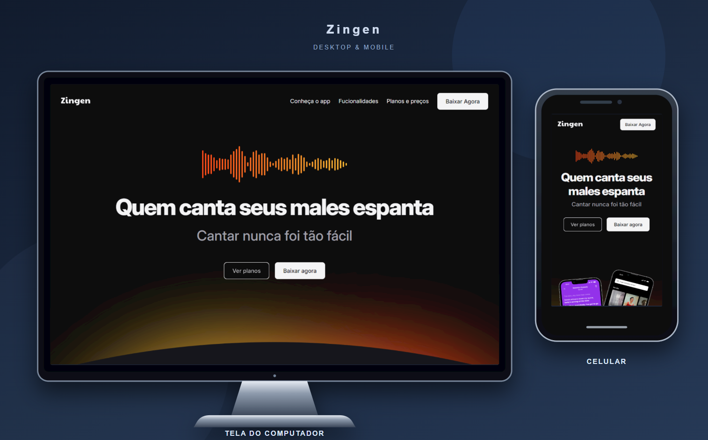

# Zingen

Landing page do aplicativo de karaokê **Zingen**, voltada para apresentar a proposta do produto, destacar as funcionalidades principais e incentivar o download do app.

  

## Sobre o projeto

O Zingen é uma experiência de karaoke moderna, com foco em facilitar a prática vocal, explorar uma grande biblioteca de músicas e tornar a performance mais dinâmica e divertida. A página foi criada como uma vitrine digital do app, com proposta visual premium, seções de apresentação, planos e chamada para ação.

## Funcionalidades apresentadas

- Hero section com proposta de valor e CTA para download.
- Seção de apresentação do app e benefícios para o usuário.
- Destaque de recursos como remoção de voz, gravações e letras em tempo real.
- Cards com funcionalidades do produto.
- Seção de planos e preços.
- Área de download com botões para App Store e Google Play.
- Layout responsivo para desktop e mobile.

## Tecnologias

- **HTML5** — estrutura do site e semântica das seções.
- **CSS3** — estilos, layout responsivo, cards, botões e identidade visual.
- **Assets SVG e imagens** — suporte visual para elementos gráficos e ilustrações.

## Como visualizar o projeto

Veja também a versão publicada:

[Zingen | Karaoke app](https://edivilhian-h.github.io/Zingen/)

## Observação

Este é um projeto front-end de landing page para divulgação do app Zingen. Ele representa a interface visual e proposta de valor do produto, sem integração com backend, autenticação ou processamento de dados em tempo real.
